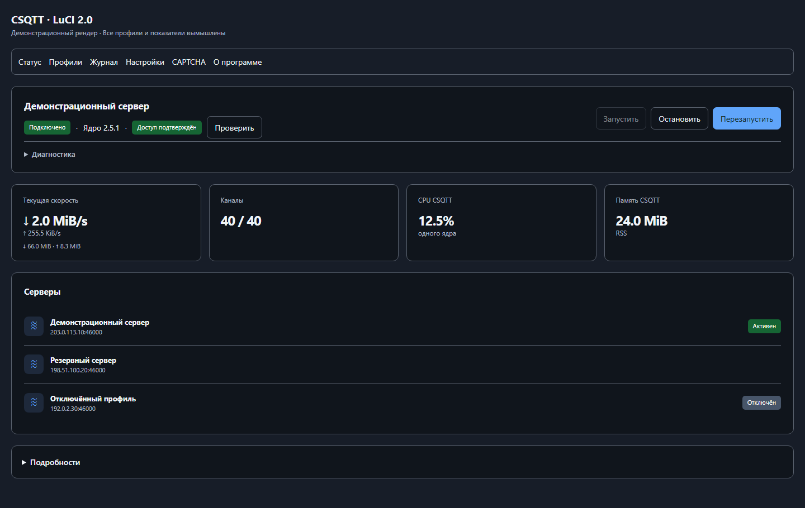
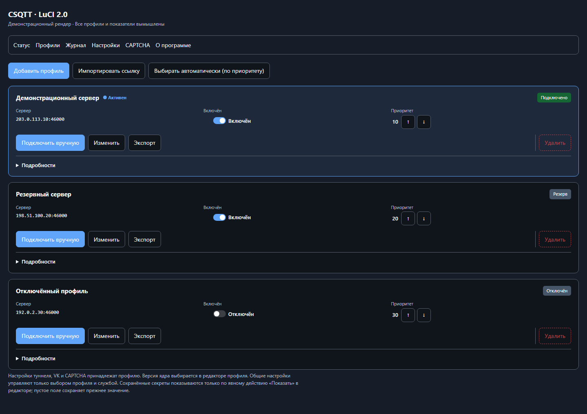

# CSQTT для OpenWrt

**CSQTT** подключает роутер на OpenWrt к серверу CSQTT и позволяет управлять
подключением через веб-интерфейс LuCI на русском языке. В поставке **два
независимых клиентских ядра** — 2.1.9 и 2.5.1 — и **необязательная** панель
LuCI. Можно установить одно ядро или оба; панель не обязательна.

Чтобы пользоваться туннелем, нужны **два условия**:

1. **данные сервера CSQTT** — ссылка подключения `csqtt://…` (адрес сервера и
   пароль);
2. **направление трафика** — отдельный прокси-клиент, привязанный к интерфейсу
   `csqtt0`.

Сама по себе установка CSQTT **не переводит** весь интернет домашних устройств в
туннель: CSQTT поднимает интерфейс `csqtt0` и не меняет маршруты, системный DNS,
firewall и NAT (подробнее — [сетевой контракт](docs/network-contract.md)).

**Коротко о главном:**

- Уже есть ссылка подключения — [установка на роутер](docs/install.md).
- Нужен собственный сервер — [инструкция для VPS](docs/server.md).
- Готовые команды для копирования — [установка и удаление](#быстрые-команды).
- Отличия ядер и выбор — [обновление и откат](docs/update.md).

## Версии в интерфейсе роутера

| Компонент | Отображаемая версия |
|---|---:|
| Панель LuCI | **2.0** |
| Ядро CSQTT | **2.1.9** |
| Ядро CSQTT | **2.5.1** |

В LuCI пользователь видит именно эти названия, **без суффиксов сборки** вроде
`rN`. Внутренние ревизии пакетов используются только пакетным менеджером, если
нужны для обновления и отката.

**Откуда «Ядро 2.5.1».** Внутренний пакет называется `csqtt-core-2.5.0` и
сохраняет номер **2.5.0** во всех ключах и путях. Отображаемое «2.5.1» — это
сборка на базе **CSQTT 2.5.0** (vendored) с принятыми **community-патчами
клиента и сервера** и локальными доработками проекта. Это **не новая версия
wire-протокола**. Имя пакета и внутренние ключи `2.5.0` намеренно не
переименовывались, чтобы обновление и откат оставались совместимыми.

## Внутренние пакеты и публичные имена файлов

Отображаемое имя, **внутреннее имя пакета** и **имя файла** различаются.
Внутренние имена и версии/ревизии сохраняются прежними.

| Показано в LuCI | Внутренний пакет | Внутренняя версия |
|---|---|---|
| Панель LuCI 2.0 | `luci-app-csqtt` | `2.0` (сборка `rN`) |
| Ядро 2.1.9 | `csqtt-core-2.1.9` | `2.1.9` (сборка `rN`) |
| Ядро 2.5.1 | `csqtt-core-2.5.0` | `2.5.0` (сборка `rN`) |

**Публичные имена файлов выпуска (`core` — версия ядра, `<release>` — `24.10` /
`25.12` / `snapshot`, `<arch>` — архитектура):**

| Пакет | Публичное имя файла (25.12/SNAPSHOT — `.apk`; 24.10 — `.ipk`) |
|---|---|
| Ядро 2.1.9 | `csqtt-core-2.1.9-openwrt-<release>-<arch>.<apk\|ipk>` |
| Ядро 2.5.1 | `csqtt-core-2.5.1-openwrt-<release>-<arch>.<apk\|ipk>` |
| Панель LuCI 2.0 | `luci-app-csqtt-2.0-openwrt-<release>.<apk\|ipk>` |

Примеры: `csqtt-core-2.1.9-openwrt-25.12-aarch64_cortex-a53.apk`,
`csqtt-core-2.5.1-openwrt-24.10-x86_64.ipk`,
`luci-app-csqtt-2.0-openwrt-snapshot.apk`.

Ядро 2.5.0 в публичном имени обозначено **2.5.1**; `install-csqtt.sh`
сопоставляет его автоматически. Пакет внутри остаётся `csqtt-core-2.5.0` с
версией `2.5.0`. Подробности — в
[перечне релизных файлов](docs/release-files.md).

Точные SHA-256 — всегда в `SHA256SUMS` рядом с пакетами (это источник истины).

## Возможности

- Импорт и редактирование профилей CSQTT (`csqtt://`), в том числе через панель.
- **Ручной выбор ядра** 2.1.9 или 2.5.1 для профиля; можно установить одно ядро
  или оба.
- Хранение **нескольких серверных профилей**, активный — ровно один;
  переключение профиля меняет сервер единственного туннеля.
- `failover`/`failback` внутри пула профилей, пороги, `cooldown`, health-check.
- Статус службы и туннеля, каналы, скорость, CPU и память процесса.
- Управление профилями, настройками, журналом и CAPTCHA из LuCI.
- Русский интерфейс панели на любом языке остального LuCI.
- Постоянный `csqtt0` при включённом `persistent_tun`.
- Ручная проверка VK-хешей с индивидуальными результатами без перезапуска ядра.
- Ручная проверка доступности и задержки TURN-подсетей без запросов к VK.
- Секреты подключения не показываются повторно в панели и обычных логах.

Подробнее о возможностях — [расширенные настройки](docs/advanced.md) и
[страницы панели](docs/luci.md).

## Панель

**Демонстрационные рендеры панели 2.0.** Все профили, адреса и показатели
вымышлены; это иллюстрации интерфейса, а не замеры производительности.





[Все разделы и версии](screenshots/README.md).

## Поддерживаемые платформы

| Линия OpenWrt | Менеджер / формат | Архитектуры |
|---|---|---|
| 24.10.x | `opkg` / `.ipk` | aarch64_cortex-a53, aarch64_generic, x86_64, arm_cortex-a7_neon-vfpv4 |
| 25.12.x | `apk` / `.apk` | aarch64_cortex-a53, aarch64_generic, x86_64, arm_cortex-a7_neon-vfpv4 |
| SNAPSHOT | `apk` / `.apk` | aarch64_cortex-a53 |

На каждую платформу — **два самостоятельных ядра** и **необязательная панель**
(панель — `architecture all`, одинакова для всех платформ). **MIPS не
поддерживается и не собирается.**

> Вся матрица выше собрана в рамках подготовки выпуска 2.0 (9 ячеек: 4
> архитектуры 24.10, 4 архитектуры 25.12, одна SNAPSHOT). Старые пакеты прежних
> выпусков не выдавайте за пакеты 2.0 — сверяйте `SHA256SUMS` и имена файлов.

## Установка на OpenWrt

> Все команды ниже выполняются **на роутере по SSH** (`ssh root@<IP-роутера>`).
> Скопируйте пакеты и `SHA256SUMS` на роутер в `/tmp` заранее.

### Что устанавливать

| Что нужно | Что устанавливать |
|---|---|
| Одно ядро без панели | `csqtt-core-2.1.9` **или** `csqtt-core-2.5.0` |
| Оба ядра без панели | `csqtt-core-2.1.9` + `csqtt-core-2.5.0` |
| Ядро 2.1.9 с панелью | `csqtt-core-2.1.9` + `luci-app-csqtt` |
| Ядро 2.5.1 с панелью | `csqtt-core-2.5.0` + `luci-app-csqtt` |
| Оба ядра с панелью | все три пакета |

Зависимости (в том числе подходящий `kmod-tun`) подтягиваются из репозитория
устройства и должны соответствовать версии OpenWrt на роутере. Отдельного
управляющего пакета `csqtt` и пакета перевода больше нет.

### Автоматически

Откройте меню [командой установки](#быстрые-команды): выберите только панель,
одно ядро с панелью или без неё, оба ядра с панелью или без неё.
Установщик определяет OpenWrt и архитектуру, проверяет SHA-256 и зависимости,
сохраняет конфигурацию и устанавливает выбранный состав.

Для обновления одного ядра с сохранением LuCI используйте
[режим «только ядро»](docs/update.md#обновление-только-ядра).

### Вручную (с панелью LuCI)

Сначала проверьте целостность рядом с файлами, затем установите. Если скачаны
только пакеты вашей платформы, используйте [проверку выбранного файла](docs/install.md),
а не проверку всего манифеста.

**OpenWrt 25.12.x / SNAPSHOT (`apk`):**

```sh
# на ПК рядом с полной поставкой и SHA256SUMS:
sha256sum -c SHA256SUMS

# на роутере, файлы предварительно скопированы в /tmp:
apk update
apk add --allow-untrusted \
  /tmp/csqtt-core-2.1.9-openwrt-25.12-aarch64_cortex-a53.apk \
  /tmp/csqtt-core-2.5.1-openwrt-25.12-aarch64_cortex-a53.apk \
  /tmp/luci-app-csqtt-2.0-openwrt-25.12.apk
```

**OpenWrt 24.10.x (`opkg`):**

```sh
opkg update
opkg install --force-reinstall \
  /tmp/csqtt-core-2.1.9-openwrt-24.10-aarch64_cortex-a53.ipk \
  /tmp/csqtt-core-2.5.1-openwrt-24.10-aarch64_cortex-a53.ipk \
  /tmp/luci-app-csqtt-2.0-openwrt-24.10.ipk
```

> `--allow-untrusted` (apk) нужен, потому что пакеты собраны локально и не
> подписаны ключом репозитория OpenWrt. `--force-reinstall` у opkg отвечает
> за повторную установку той же версии, а не за доверие подписи. При понижении версии добавляется
> `--force-downgrade` (без него `opkg` молча ничего не меняет).

После установки откройте LuCI → **Службы → CSQTT**.

### Вручную (без панели LuCI)

Если панель не нужна, установите только выбранное ядро — например 2.5.1:

```sh
apk update
apk add --allow-untrusted /tmp/csqtt-core-2.5.1-openwrt-25.12-aarch64_cortex-a53.apk
```

Общие точки входа (`/usr/bin/csqtt`, `/etc/init.d/csqtt`,
`/etc/logrotate.d/csqtt`) создаёт **активное ядро**: приоритет у 2.1.9, затем
2.5.0, независимо от порядка установки. Если установлено только ядро 2.5.0,
движок 2.1.9 недоступен и не подменяется.

### Первоначальная настройка

**В LuCI:**

1. **Профили → Импортировать ссылку** (или **Добавить профиль**) и заполните поля: сервер
   `host:port`, пароль, при необходимости VK-хеши или ссылки.
2. Для режима `auto_js` укажите **VK JS token** (токен VK или полный OAuth
   redirect-URL); профиль включайте только после установки токена.
3. Включите профиль (**Профиль включён**).
4. Включите службу: **Настройки → CSQTT включён**, затем **Запустить** на
   странице «Статус».
5. Проверьте **Status**: служба запущена, есть сессия, идёт трафик.

**Без LuCI (UCI и CLI)** — полный набор параметров в
[настройках](docs/advanced.md):

```sh
# локальный импорт ссылки; замените заглушку своими данными:
csqtt profile import 'csqtt://connect?...' --id myserver --commit

# явный выбор ядра и профиля; 2.5.0 — внутренний ключ ядра 2.5.1:
csqtt profile set myserver core_version 2.5.0
csqtt profile enable myserver
csqtt profile use myserver
uci set csqtt.main.enabled='1'
uci set csqtt.main.persistent_tun='1'      # постоянный csqtt0 (необязательно)
uci commit csqtt

service csqtt start                        # = /etc/init.d/csqtt start
# service csqtt stop | restart | reload | enable | disable

# проверка состояния:
csqtt status             # 0 подключён / 1 нет / 2 служба не запущена
csqtt doctor             # read-only диагностика: конфиг, TUN, peer, rp_filter
csqtt log tail -n 50 -f  # журнал с маскировкой секретов
ip -4 addr show csqtt0
curl --interface csqtt0 --max-time 15 https://1.1.1.1/cdn-cgi/trace
```

Если внешний IP в ответе `curl` совпадает с IP сервера CSQTT (а не с WAN),
трафик действительно идёт через туннель. Секреты (`password`, `vk_js_token`,
VK-хеши, `device_id`) в `status`/логах не выводятся; `device_id` привязан к
паролю на сервере — переносите как есть, **не генерируйте новый**.

## Быстрые команды

**Установка** (на роутере по SSH):

```sh
wget --no-proxy -qO /tmp/csqtt-install.sh https://raw.githubusercontent.com/starkugz/csqtt-openwrt/v2.0/install-csqtt.sh \
  && ash /tmp/csqtt-install.sh --menu
```

Меню предлагает панель отдельно, одно или оба ядра с панелью либо без неё.
Установка пакетов не запускает туннель автоматически: после установки ядер
настройте профиль и выполните `service csqtt restart`. При установке только
панели перезапуск ядра не нужен.
Обновление одного ядра без переустановки LuCI — [отдельная команда](docs/update.md#обновление-только-ядра).

**Удаление** (сохраняет `/etc/config/csqtt`; снимает автозапуск и удаляет только
пакеты CSQTT):

```sh
wget --no-proxy -qO /tmp/csqtt-uninstall.sh https://raw.githubusercontent.com/starkugz/csqtt-openwrt/v2.0/uninstall-csqtt.sh \
  && ash /tmp/csqtt-uninstall.sh
```

Удаление на роутере серверную часть на VPS не затрагивает.

## Обновление и откат

Ядра и панель обновляются независимо; профили и `/etc/config/csqtt` сохраняются
как conffile. Новый набор скачайте в `/tmp`, проверьте по `SHA256SUMS` и
установите; затем перезапустите службу:

```sh
apk add --allow-untrusted /tmp/csqtt-core-2.5.1-openwrt-25.12-aarch64_cortex-a53.apk
apk add --allow-untrusted /tmp/luci-app-csqtt-2.0-openwrt-25.12.apk   # необязательно
service csqtt restart
```

Откат — установка прежних файлов пакетов с понижением версии и перезапуск
службы. Полные команды, различие `apk`/`opkg` и тонкости версий — в
[обновлении и удалении](docs/update.md).

## Сервер CSQTT (отдельная поставка)

Сервер устанавливается и обновляется **отдельно** от роутерной панели.
Серверных вариантов два, как и клиентских ядер:

- **Сервер 2.1.9** — официальный закреплённый релиз upstream `amurcanov/csqtt`
  v2.1.9; включён в серверный комплект с проверкой SHA-256;
- **Сервер 2.5.1** — база CSQTT 2.5.0 + community-патч `01`; включён в серверный комплект для некоммерческого использования
  с сохранением лицензии и обязательных уведомлений.

Оба варианта **не переключаются автоматически** и не запускаются одновременно на
одном сервере. Проверенная схема: Linux (Ubuntu/Debian) x86-64 с `systemd`;
служба `csqtt`, бинарник `/usr/local/bin/csqtt`, каталог `/etc/csqtt`, интерфейс
`csqtt1`, UDP-порт `46000`, TCP-порт панели `46002`.

**Меню установки сервера** (на VPS от root):

```sh
curl -fL --connect-timeout 15 --max-time 60 -o /tmp/csqtt-server-menu.sh \
  https://raw.githubusercontent.com/starkugz/csqtt-openwrt/v2.0/install-server.sh \
  && bash /tmp/csqtt-server-menu.sh --menu
```

Выберите сервер 2.1.9, сервер 2.5.1 или удаление службы CSQTT с сохранением данных.

После успешной установки скрипт покажет HTTPS-адрес, случайные логин и пароль
панели. Они сохраняются при перезапуске и обновлении. Подробности и повторный
просмотр доступа — в [первом входе](docs/server.md#как-войти-в-панель-после-установки).
SHA-256 в сообщении установщика — контрольная сумма, а не пароль.
Для установки нужны Linux x86-64, systemd, TUN и зависимости из [инструкции](docs/server.md).
Установщик скачивает только выбранный бинарник и проверяет SHA-256.

Дополнительные инструменты:

- **[`server-install.sh`](server-install/README.md)** — **установка с нуля**
  (по образцу официального `deploy.sh`), а также обновление «под ключ» и точный
  откат: создаёт unit `csqtt`, хелперы `network-up.sh`/`tun-recover.sh`, каталог
  `/etc/csqtt`, файлы `sysctl`, проверяет ELF/SHA-256, выполняет health-check и
  при провале автоматически откатывается;
- **[`server-deploy.sh`](docs/server.md)** — только **замена бинарника** уже
  развёрнутой службы (`preflight`/`install`/`update`/`status`/`verify`/`rollback`).

Точные SHA-256 обоих серверных вариантов и порядок установки — в
[инструкции для VPS](docs/server.md).

> **Проверка установки:** обе серверные версии установлены последовательно
> в согласованном окне; итоговая 2.5.1. Служба, порты, сохранность данных и
> ответ панели проверены. Клиентский трафик и реальный откат не проверялись.

## Сетевой контракт клиента OpenWrt: interface-only

CSQTT не становится шлюзом по умолчанию и **не меняет** маршруты, правила,
таблицы, системный DNS/dnsmasq, firewall и NAT. Поднимается только TUN-интерфейс
`csqtt0`; через него идёт **только** трафик процессов, явно привязанных к
интерфейсу (`SO_BINDTODEVICE`). Control-plane CSQTT/VK/TURN остаётся через WAN.
Использование туннеля и примеры для прокси — в
[совместимости](docs/compatibility.md) и
[сетевом контракте](docs/network-contract.md).

## Лицензия

Проект использует условия лицензий, перечисленные в [`LICENSE`](LICENSE) и
[`NOTICE.md`](NOTICE.md). Компоненты community распространяются с сохранением их
исходных лицензий и обязательных уведомлений. **PolyForm Noncommercial 1.0.0** —
только некоммерческое использование.

## Документация

- [Установка на роутер](docs/install.md)
- [Обновление, откат и удаление](docs/update.md)
- [Панель LuCI](docs/luci.md)
- [Расширенные настройки](docs/advanced.md)
- [Свой сервер на VPS](docs/server.md)
- [Совместимость с прокси-клиентами](docs/compatibility.md)
- [Сетевой контракт](docs/network-contract.md)
- [Диагностика](docs/troubleshooting.md)
- [Происхождение и версии](docs/build.md)
- [Перечень релизных файлов](docs/release-files.md)
- [Выпуск CSQTT 2.0](docs/release-v2.0.md)
