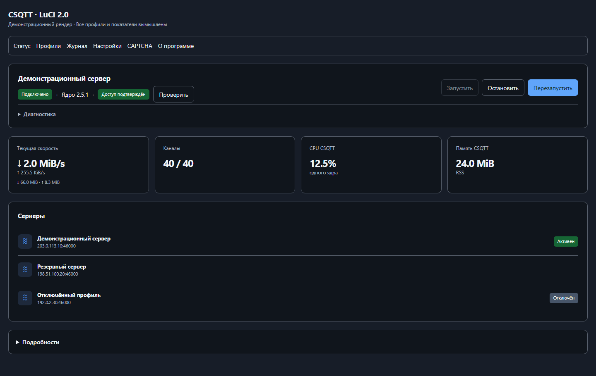
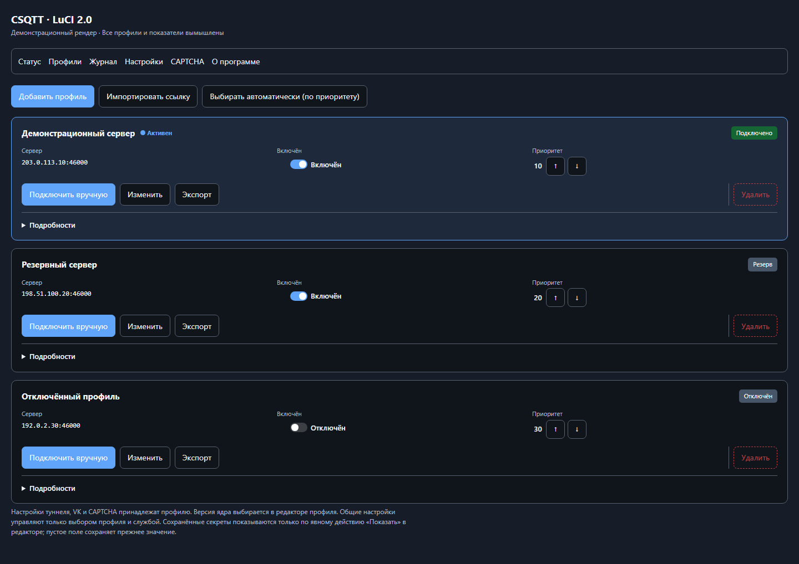
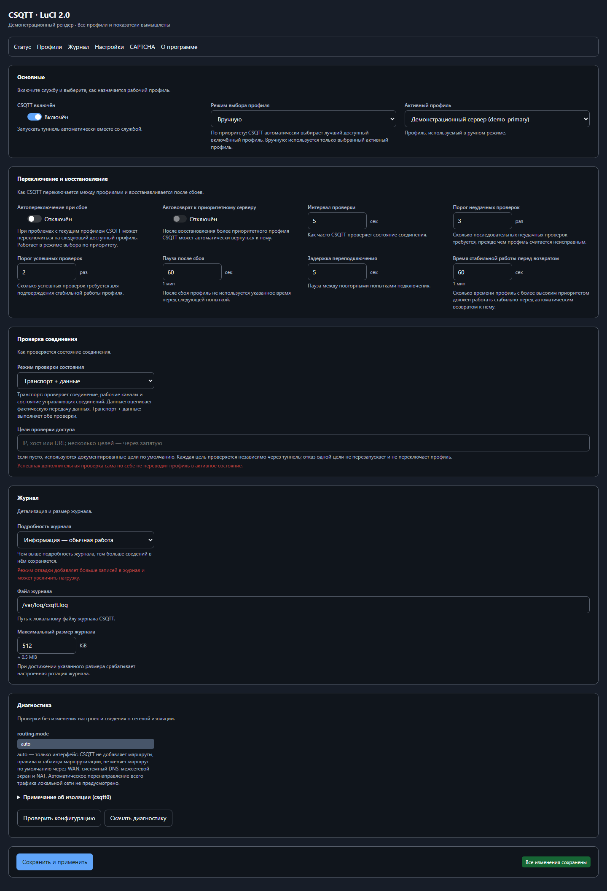
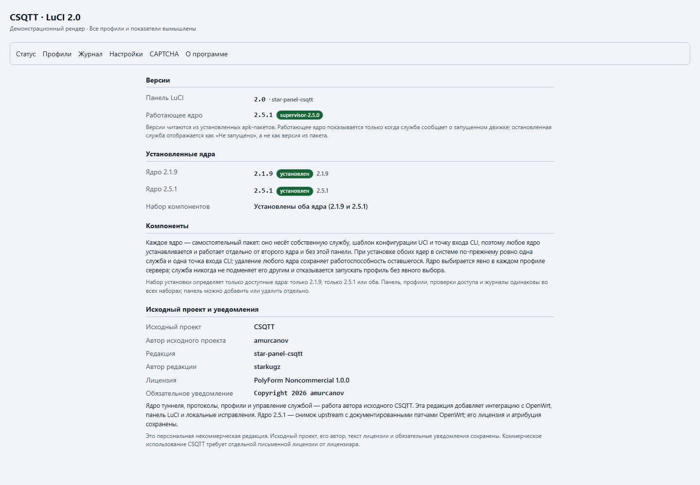
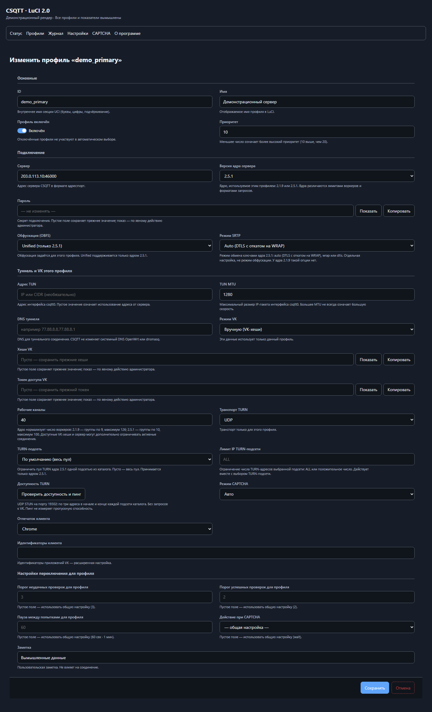
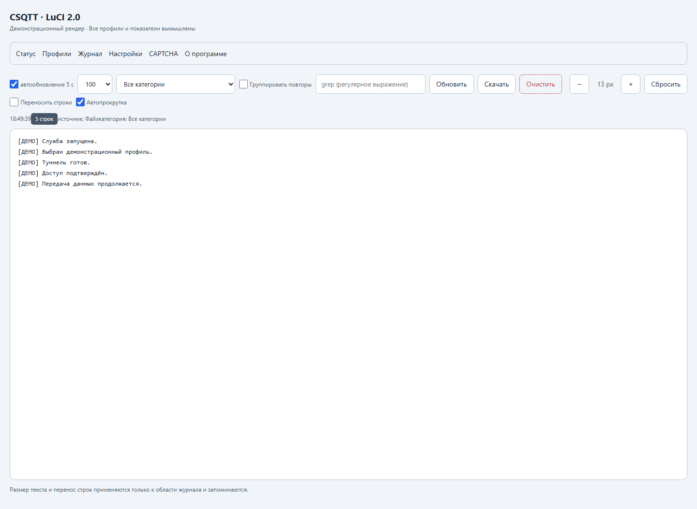

# Панель LuCI 2.0 — демонстрация

Шесть настольных кадров — **демонстрационные рендеры**, созданные из файлов
публикуемого пакета LuCI 2.0. Профили, адреса, журнал и показатели вымышлены.
Это иллюстрации интерфейса, а не замеры скорости или живая проверка роутера.
Сеть в странице отключена, RPC заменён локальными демонстрационными ответами.
Внешняя оболочка имитирует тему LuCI. Код представлений панели не изменялся.

Из PNG удалены текстовые, временные и EXIF-метаданные. Хеш пакета, хеши
отрисованных JS-модулей и размеры кадров — в [SOURCES.json](SOURCES.json).
Все публикуемые кадры имеют ширину 1440 px. Мобильные кадры в выпуск не входят.

## Статус — тёмная тема

## Профили — тёмная тема

## Настройки — тёмная тема

## О программе — версии и авторство

## Редактор профиля 2.5.1

## Журнал — синтетические строки

